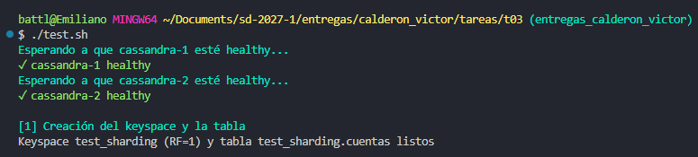
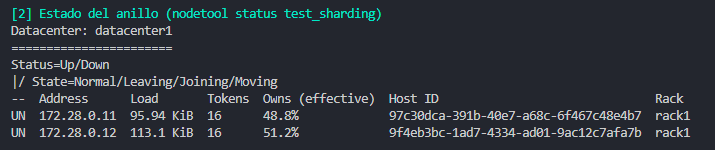
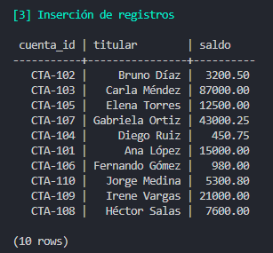
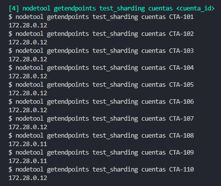
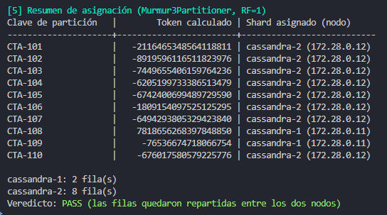

# T03: Implementación Real de Sharding - Apache Cassandra

**Nombre:** Victor Emiliano Calderón Gutiérrez  

---

## 1. Qué es y para qué se usa.

Comenzando desde lo general, el sharding es una forma de trabajar las bases de datos de forma distribuida. Durante la carrera, hemos tenido la oportunidad de trabajar con BD en una sola ubicación; el problema es que si la aplicación crece lo suficiente, entonces podríamos llegar a enfrentarnos con cuellos de botella, ya que podríamos tener CPU, RAM y disco limitados (escalamiento vertical). Mientras tanto, el sharding es una técnica para poder hacer escalamiento horizontal, por lo que nos permite conseguir más nodos para entonces distribuir la carga por distintos servidores. 

De forma particular, Cassandra es una base de datos NoSQL que implementa el sharding. Fue creada por Facebook para hacer búsquedas en la bandeja de mensajes. Con el tiempo migró a ser de código abierto y ahora es implementada por muchas empresas. Una de sus características es que no tiene nodo maestro. También se usa principalmente para series de tiempo, internet de las cosas (IoT), logs, y mensajería. 

## 2. Cómo reparte los datos: ¿por rango, por hash o de otra forma? ¿Quién elige la llave?

Al buscar en la documentación encontré que la forma en que se reparten los datos en Cassandra es mediante el uso de un hash. Esta base de datos utiliza un componente llamado "Partitioner" que es un algoritmo que genera un hash de 64 bits. 

Para el lado de la llave, esta se elige por nosotros, los desarrolladores. Esto dependerá totalmente de la información que nosotros consideremos más relevante, ya que se elige con el PRIMARY KEY.

## 3. Cómo encuentra el shard correcto cuando llega una consulta: ¿quién guarda el mapa de qué dato vive dónde?

Como mencionamos en la primera pregunta, Cassandra no tiene un nodo maestro, lo cual hace que al momento de ejecutar una búsqueda no haya un nodo principal al cual podamos acceder para saber después a cuál dirigirnos. Lo que hace en cambio es que entra a cualquier nodo disponible, o el primero que responda a la petición. TODOS los nodos tienen el mapa de la BD y cada cierto tiempo se comparten la información por gossip (chisme), por lo que no importa a cuál entren. Una vez dentro de cualquier nodo, se genera el hash y de ahí redirige al nodo que contenga el hash buscado.

## 4. Qué pasa cuando agregas un shard: ¿se mueven los datos? ¿cuántos?

Una de las ventajas de la arquitectura de Cassandra es que el ordenamiento de los hash es por un anillo dividido en rangos, lo que significa que cada uno de los nodos es dueño de un rango específico de hashes. Por lo que si se agregan, o eliminan, nodos, los hashes no se recalculan; más bien, los rangos del anillo se modifican, y al final, solo los datos que caen en el rango que tomó el nuevo nodo se mueven a él. Los demás se quedan donde estaban.

Este concepto no me quedaba del todo claro y le pedí a la IA que me ayudara a entenderlo con un ejemplo, el ejemplo es el siguiente:

Imaginemos un anillo de juguete donde los tokens (hashes) van de 0 a 99. Cada nodo tiene una posición en el anillo y cada clave va al primer nodo cuyo token sea mayor o igual al token de la clave.

Con 2 nodos, A en 50 y B en 99:

| Rango de tokens | Dueño |
| :--- | :--- |
| 0 a 50 | A |
| 51 a 99 | B |

Ahora entra un nodo C en 80. Ese nuevo punto parte el rango de B en dos:

| Rango de tokens | Dueño |
| :--- | :--- |
| 0 a 50 | A (no cambia) |
| 51 a 80 | C (antes era de B) |
| 81 a 99 | B |

Las claves conservan su token; lo único que cambia es quién es dueño de cada rango:

| Clave | Token | Antes | Después | ¿Se mueve? |
| :--- | ---: | :--- | :--- | :--- |
| CTA-1 | 20 | A | A | No |
| CTA-2 | 45 | A | A | No |
| CTA-3 | 70 | B | C | Sí |
| CTA-4 | 90 | B | B | No |

Solo CTA-3 se copia de B a C. En general se mueve aproximadamente 1/(N+1) de los datos (de 2 a 3 nodos, cerca de un tercio). Si en lugar del anillo se usara `hash(clave) mod N`, al cambiar N casi todas las claves cambiarían de nodo. En Cassandra real los tokens son de 64 bits y cada nodo pone 16 puntos en el anillo (vnodes), así que el nodo nuevo toma pedacitos de todos los demás en lugar de un solo bloque.


## 5. Qué hace con un shard caliente, si hace algo.

Una de las desventajas de Cassandra, es que no hace manejo de un shard caliente de forma automática, de eso nos encargamos nosotros como desarrolladores. Existen un par de trucos que se usan: como usar una PRIMARY KEY con más elementos, o una técnica llamada "Salting", que nos pide agregar un sufijo para que entonces los hashes no caigan en el mismo rango.

---

## 6. Comprobación práctica con Docker Compose (Opcional)

### 6.1. Qué se levanta

`docker-compose.yml` levanta un clúster de Cassandra con dos nodos; cada nodo es un shard.

| | `cassandra-1` | `cassandra-2` |
| :--- | :--- | :--- |
| Imagen | `cassandra:5.0` | `cassandra:5.0` |
| Rol | Seed: el nodo de contacto con el que arranca el clúster | Se une al clúster contactando a `cassandra-1` |
| IP fija | `172.28.0.11` | `172.28.0.12` |
| Arranque | Inmediato | Espera a que `cassandra-1` esté healthy |

- **Memoria:** `MAX_HEAP_SIZE: "512M"` y `HEAP_NEWSIZE: "100M"` para que cada nodo no ocupe demasiada RAM en una máquina de desarrollo.
- **Healthcheck:** `cqlsh -e "describe cluster"`. El nodo se marca healthy cuando ya acepta consultas.
- **IPs fijas:** `nodetool` responde con IPs, así que fijarlas permite saber a qué nodo corresponde cada una.

### 6.2. Cómo se prueba

```bash
cd entregas/calderon_victor/tareas/t03
docker compose up -d
chmod +x test.sh
./test.sh
```

`test.sh` hace cinco pasos:

1. Espera a que los dos nodos estén healthy y crea el keyspace y la tabla.
2. Muestra el estado del anillo con `nodetool status test_sharding`.
3. Inserta 10 cuentas, de `CTA-101` a `CTA-110`.
4. Corre `nodetool getendpoints` por cada cuenta para ver qué nodo la guarda.
5. Imprime un resumen con el token de cada cuenta y el nodo que le tocó.

Para apagar el clúster al terminar:

```bash
docker compose down
```

### 6.3. Esquema

```sql
CREATE KEYSPACE IF NOT EXISTS test_sharding
  WITH replication = {'class': 'SimpleStrategy', 'replication_factor': 1};

CREATE TABLE IF NOT EXISTS test_sharding.cuentas (
  cuenta_id text PRIMARY KEY,
  titular   text,
  saldo     decimal
);
```

- **`replication_factor: 1`:** cada fila se guarda en un solo nodo, así que el nodo que la guarda es su shard.
- **`cuenta_id`:** es la partition key. Cassandra calcula el hash de este valor para decidir en qué nodo queda la fila.

### 6.4. Ejecución de `./test.sh`

#### Paso 1. Nodos listos y creación del keyspace



#### Paso 2. Estado del anillo



#### Paso 3. Inserción de registros



#### Paso 4. `nodetool getendpoints` por cuenta



#### Paso 5. Resumen de asignación



**Resultado:** `cassandra-1` quedó con 2 cuentas y `cassandra-2` con 8. El anillo está dividido casi a la mitad (48.8% / 51.2% en el paso 2), pero con solo 10 claves el hash no reparte parejo: cada clave cae en un punto del anillo según su hash y, con tan pocas, el azar pesa. Con miles de claves el reparto se acercaría a esos porcentajes.

---

## 7. Fuentes consultadas

- Apache Cassandra Documentation (5.0). *Dynamo*: anillo de tokens, consistent hashing y vnodes. https://cassandra.apache.org/doc/latest/cassandra/architecture/dynamo.html
- Apache Cassandra Documentation (5.0). *nodetool getendpoints*. https://cassandra.apache.org/doc/latest/cassandra/managing/tools/nodetool/getendpoints.html
- Carpenter, J., & Hewitt, E. (2020). *Cassandra: The Definitive Guide* (3rd ed.). O'Reilly Media.
