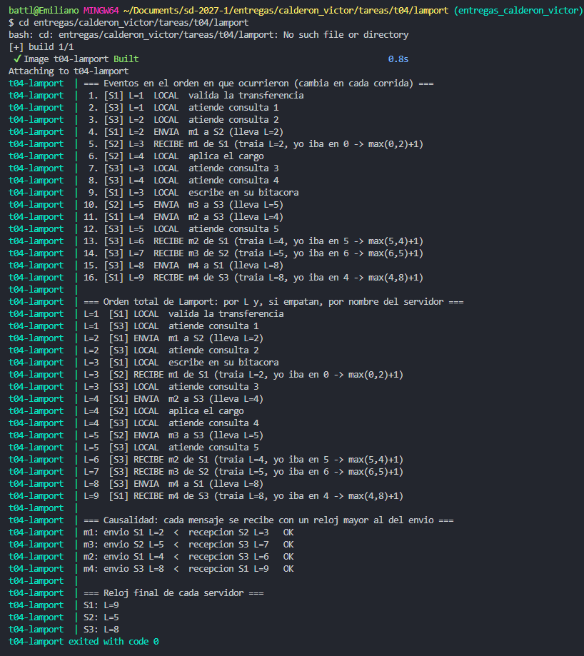

# T04 · ¿Qué reloj usan las tecnologías que conoces?

**Nombre:** Victor Emiliano Calderón Gutiérrez  

---

Tal como lo vimos en la clase, el reloj de pared no sirve para ordenar eventos en un sistema distribuido, ya que NTP acerca los relojes pero nunca los deja iguales, y además un reloj puede brincar hacia atrás (por una corrección de NTP, un problema de la máquina virtual o un segundo intercalar). Para esta tarea elegí MongoDB, Cassandra y Redis, ya que con MongoDB y Redis trabajamos en el lab S11 (la bitácora de avisos y la caché del saldo) y Cassandra fue la tecnología que investigué en la T03, entonces me interesó saber qué reloj traen por detrás las tecnologías que ya había usado. Lo que encontré es que cada una resuelve el problema de una forma muy distinta: MongoDB usa un reloj híbrido, Cassandra confía en el reloj de pared y Redis prácticamente lo evita.

## 1. MongoDB

### 1.1. Qué es y para qué se usa.

MongoDB es una base de datos NoSQL de documentos, es decir, en lugar de tablas guarda documentos parecidos a JSON (en formato BSON). Se usa mucho cuando la estructura de los datos cambia o no es tan rígida, como en catálogos, perfiles de usuario o bitácoras; justamente en el lab S11 la usamos para guardar el registro de avisos de cada transferencia. Normalmente se despliega en un "replica set", donde hay un nodo primario que recibe todas las escrituras y varios secundarios que copian lo que hace el primario, y si se necesita crecer horizontalmente se hace sharding, donde cada shard es a su vez un replica set.

### 1.2. Qué tiempo usa para ordenar.

Por lo que estuve investigando, MongoDB usa un reloj híbrido (HLC, "Hybrid Logical Clock"), que es una mezcla entre el reloj físico y un reloj lógico estilo Lamport. Cada escritura que hace el primario se anota en el "oplog" (una colección especial que los secundarios van leyendo para copiar los cambios) con un campo `ts` de tipo Timestamp, que está formado por dos partes: los segundos de la hora de pared y un contador que distingue las operaciones que caen en el mismo segundo. Los secundarios aplican el oplog en el orden de ese `ts`.

Además, desde la versión 3.6 existe el "cluster time", que viaja en todos los mensajes entre los nodos, los `mongos` y los drivers (cada respuesta trae un campo `$clusterTime`). Lo interesante es que funciona igual que Lamport: si un nodo recibe un cluster time más grande que el suyo, se adelanta a ese valor, que es el mismo `max(local, recibido)` que implementé en el opcional. En el paper donde explican su implementación (Tyulenev et al., 2019) dicen que eligieron el reloj híbrido en lugar de Lamport, relojes vectoriales o el reloj de pared, porque la parte física hace que el valor se parezca a la hora real y la parte lógica asegura que nunca retroceda.

### 1.3. Qué orden te garantiza y hasta dónde.

Dentro de un replica set hay un orden total de las escrituras, ya que solo el primario escribe y es el que numera las operaciones en el oplog, por lo que todos los secundarios ven los cambios en el mismo orden. Entre shards ya no hay un solo oplog, pero el cluster time da un punto en común para que las transacciones que tocan varios shards lean de una misma "foto" de los datos y tengan un mismo tiempo de commit.

Algo importante es que MongoDB también ofrece "sesiones causalmente consistentes", donde el driver va guardando el tiempo de tu última operación y el nodo que atiende la siguiente espera a estar al corriente antes de responder. Dentro de esa sesión te garantiza cuatro cosas: que lees lo que tú mismo escribiste ("read your writes"), que una lectura nunca te regresa algo más viejo que una lectura anterior ("monotonic reads"), que tus escrituras se aplican en el orden en que las hiciste ("monotonic writes") y que una escritura que haces después de leer ya toma en cuenta lo que leíste ("writes follow reads"). Eso sí, solo se cumple si las lecturas y escrituras usan `"majority"`, y la garantía es por sesión, no para todo el sistema: dos clientes con sesiones distintas no tienen asegurado ver las cosas en el mismo orden.

### 1.4. Qué pasa cuando los relojes no coinciden.

Como el orden depende del contador lógico y no solo de la hora, MongoDB no necesita que los relojes estén iguales para ordenar: si la hora de un nodo va atrás de un cluster time que ya vio, simplemente se queda con el valor más alto y aumenta el contador, entonces nunca retrocede. El problema que tiene un reloj estilo Lamport es que si alguien manda un número enorme, todos se adelantarían a ese valor; por eso el `$clusterTime` va firmado con una llave que solo conocen los nodos, para que un cliente no pueda mandar un tiempo inventado. Además, existe un parámetro (`maxAcceptableLogicalClockDriftSecs`) que pone un tope a qué tanto puede alejarse el cluster time de la hora de pared del nodo, que por defecto es de un año. Aun así, MongoDB recomienda tener NTP en todos los servidores, ya que la parte física sí se usa, por ejemplo en los índices TTL que borran documentos según la hora.

## 2. Cassandra

### 2.1. Qué es y para qué se usa.

Como lo vimos en la T03, Cassandra es una base de datos NoSQL de columnas anchas que no tiene nodo maestro: todos los nodos son iguales y se reparten los datos en un anillo de hashes. Cada dato se copia en varios nodos (según el factor de replicación) y el cliente decide cuántos de ellos tienen que contestar con el "consistency level" (`ONE`, `QUORUM`, `ALL`). Se usa principalmente donde hay muchísimas escrituras y se necesita que el sistema siempre esté disponible, como en series de tiempo, IoT, logs y mensajería.

### 2.2. Qué tiempo usa para ordenar.

A diferencia de MongoDB, Cassandra usa directamente el reloj físico de pared. Cada celda (cada columna de cada fila) guarda junto con su valor un timestamp en microsegundos, que se puede consultar con `WRITETIME(columna)`. Según la documentación, si nadie da un timestamp lo pone el nodo coordinador con su hora al empezar a ejecutar la sentencia, pero en la práctica los drivers actuales lo generan del lado del cliente (el driver de Java, por ejemplo, usa por defecto un generador "monotónico" en el cliente), y también se puede forzar a mano con `USING TIMESTAMP`.

Con ese timestamp resuelve los conflictos con la regla "Last Write Wins" (la última escritura gana): cuando dos réplicas tienen versiones distintas de la misma celda, ya sea al leer o al reparar, se queda la que tenga el timestamp mayor. Es decir, "la última" no es la que de verdad llegó al final, sino la que trae el número más grande. Una de las cosas que me llamó la atención es que en un `BATCH` sin timestamps todas las operaciones llevan el mismo, por lo que se pueden aplicar en un orden diferente al que se escribieron.

### 2.3. Qué orden te garantiza y hasta dónde.

El único orden que garantiza es por celda, y según el timestamp. No hay un orden total ni entre filas, ni entre particiones, ni entre clientes distintos; dentro de una partición las filas sí están ordenadas, pero por las "clustering columns" de la PRIMARY KEY, lo cual es un orden por llave y no por tiempo. Si se necesita algo más fuerte existen las "lightweight transactions" (por ejemplo `INSERT ... IF NOT EXISTS`), que usan Paxos para que las operaciones queden en un orden único, pero solo dentro de una misma partición y con varias idas y vueltas entre nodos, por lo que son mucho más lentas.

### 2.4. Qué pasa cuando los relojes no coinciden.

Esta es la parte más delicada de Cassandra: lo ignora y confía en que NTP mantenga los relojes cerca. No espera, no corrige y tampoco avisa. Si el reloj de un nodo o de un cliente va atrasado, su escritura nueva puede llevar un timestamp menor que el valor que quería reemplazar y simplemente pierde, sin ningún error (por ejemplo, un usuario cambia su dirección, recarga la página y le aparece la anterior). Y si el reloj va adelantado, un `DELETE` con fecha en el futuro deja una marca de borrado (tombstone) que tapa las escrituras que vengan después hasta que esa marca se limpie, lo cual puede tardar días; Kyle Kingsbury, quien hace las pruebas de Jepsen, les llama "doomstones". Además, como las reparaciones copian a las demás réplicas la versión con timestamp mayor, el error se propaga.

Lo único que hace es proteger el orden dentro de un mismo cliente: el generador monotónico del driver nunca da un timestamp menor al anterior aunque el reloj retroceda (sigue sumando a partir del último) y escribe un aviso en el log cuando se desvía más de un segundo. Pero entre clientes distintos no hay nada que lo proteja, por eso es tan importante tener NTP bien configurado en todos los nodos y clientes, o usar lightweight transactions cuando el orden sí importa.

## 3. Redis

### 3.1. Qué es y para qué se usa.

Redis es un almacén de llave-valor que guarda todo en memoria, por lo que es muy rápido. Se usa sobre todo como caché (como en el lab S11, donde guardamos el saldo de las cuentas con un TTL de 30 segundos), pero también para sesiones, contadores, colas, pub/sub y "Streams", que son como una bitácora donde solo se agregan entradas al final. Se puede usar como una sola instancia, como un primario con réplicas que le copian (de forma asíncrona), o como Redis Cluster, donde las llaves se reparten en 16,384 "hash slots" entre varios primarios.

### 3.2. Qué tiempo usa para ordenar.

Lo que vi es que Redis prácticamente evita el problema, ya que para ejecutar los comandos no usa ningún reloj: los ejecuta en un solo hilo, uno por uno, en el orden en que le llegan, entonces nunca hay dos comandos al mismo tiempo que haya que ordenar. Para la replicación usa un número de secuencia que asigna el primario: cada primario tiene un "replication ID" y un "offset" (hasta qué byte del flujo de cambios va), y cuando una réplica se reconecta le dice al primario desde qué offset continuar (con el comando `PSYNC`).

Sí hay dos lugares donde aparece el tiempo. En los Streams, el ID de cada entrada tiene la forma `<milisegundos>-<secuencia>`, donde los milisegundos vienen de la hora local del servidor y la secuencia desempata las entradas del mismo milisegundo, es decir, es un híbrido parecido al de MongoDB. Y en Redis Cluster, para saber quién es el primario de cada slot después de una falla, usa "epochs", que son contadores lógicos: cuando un nodo recibe un mensaje con un epoch mayor que el suyo, se actualiza a ese valor (otra vez la regla de Lamport), y si dos nodos dicen ser dueños del mismo slot gana el que tenga el epoch más alto ("last failover wins"), algo muy parecido a los "terms" de Raft.

### 3.3. Qué orden te garantiza y hasta dónde.

En una sola instancia hay un orden total de todos los comandos, gracias al hilo único (y las transacciones con `MULTI/EXEC` o los scripts de Lua se ejecutan completos sin que se meta nada en medio). En Redis Cluster el orden es por slot, y por lo tanto por llave, ya que cada slot tiene un solo primario; entre llaves de slots distintos no hay orden ni transacciones. En los Streams, cada entrada nueva tiene un ID mayor que todas las anteriores, por lo que el orden está garantizado dentro de ese stream, y si uno intenta poner un ID a mano igual o menor que el último, Redis lo rechaza. Por último, las réplicas aplican los cambios en el mismo orden que el primario, pero como la replicación es asíncrona van un poco atrasadas, y si el primario se cae se pueden perder escrituras que ya se habían confirmado.

### 3.4. Qué pasa cuando los relojes no coinciden.

Para el orden de los comandos no importa, porque no depende de ningún reloj. En los Streams, si el reloj del servidor brinca hacia atrás, Redis no genera un ID menor: usa la hora de la última entrada y sigue aumentando la secuencia, por lo que los IDs siguen creciendo aunque la hora haya retrocedido (la documentación lo dice tal cual). Donde sí afecta es en el vencimiento de las llaves: Redis guarda el TTL como una fecha absoluta (en milisegundos), por lo que si el reloj cambia o se mueve un respaldo a una máquina con otra hora, las llaves vencen antes o después de lo esperado. Para que dos relojes distintos no den resultados distintos, las réplicas no expiran llaves por su cuenta, sino que esperan el `DEL` que les manda el primario cuando la llave vence.

Algo que me pareció interesante es la discusión sobre "Redlock", el algoritmo para hacer candados distribuidos con varias instancias de Redis. Martin Kleppmann argumentó que no es seguro porque depende de que los relojes no se desvíen ni brinquen respecto al tiempo de vida del candado, y propuso usar "fencing tokens", que son un número que siempre crece y se manda con cada acceso (otra vez un número de secuencia en lugar de un reloj). El creador de Redis (antirez) le respondió que con NTP bien configurado no hay saltos grandes. Al final, Redis no sincroniza nada por sí mismo, depende del NTP del sistema operativo.

## Comparación

| | MongoDB | Cassandra | Redis |
| :--- | :--- | :--- | :--- |
| Tiempo para ordenar | Híbrido: segundos + contador (cluster time) | Reloj de pared en microsegundos por celda | Orden de llegada (un hilo); offset para replicar; hora + secuencia en Streams |
| Quién lo asigna | El primario, y se propaga a todos | El cliente (driver) o el coordinador | El primario |
| Orden que garantiza | Total por replica set; causal por sesión | Por celda (Last Write Wins); por partición con LWT | Total por instancia o por slot; creciente por stream |
| Si los relojes no coinciden | El contador absorbe la diferencia, con firma y tope | Lo ignora: gana el reloj más adelantado | No afecta el orden, pero sí los TTL |

Para cerrar, me di cuenta de que las tres terminan usando de alguna forma la idea de Lamport: MongoDB en el cluster time, Redis en los epochs del clúster, y Cassandra solo dentro de cada cliente, que justo es la que más sufre cuando los relojes no coinciden.


---

## 4. Un reloj de Lamport en Java (Opcional)

### 4.1. Qué se simula

En [`lamport/Lamport.java`](lamport/Lamport.java) hay tres servidores (`S1`, `S2` y `S3`), cada uno corriendo en su propio hilo y con su reloj de Lamport en un `AtomicLong`. Tal como lo vimos en la clase, las reglas son tres:

| Evento | Qué le pasa al reloj |
| :--- | :--- |
| Local | `reloj + 1` |
| Envío | `reloj + 1`, y el mensaje viaja con ese valor |
| Recepción | `max(reloj, recibido) + 1` |

Cada servidor sigue un guion de pasos y entre ellos se mandan 4 mensajes:

| Mensaje | De | A |
| :--- | :--- | :--- |
| `m1` | S1 | S2 |
| `m2` | S1 | S3 |
| `m3` | S2 | S3 |
| `m4` | S3 | S1 |

Mientras tanto, `S3` atiende 5 consultas locales antes de recibir nada, por lo que su reloj avanza solo y llega a `L=5` antes de que le llegue algún mensaje; esto lo hice a propósito para ver los dos casos de la regla del `max`. Cada pareja de servidores tiene su propio buzón (una `LinkedBlockingQueue`), así que cuando un servidor recibe se queda esperando con `take()` hasta que el mensaje llega. Además, los hilos duermen un tiempo al azar entre paso y paso, por lo que el orden en que se imprimen los eventos cambia de una corrida a otra, pero los valores del reloj siempre son los mismos, ya que solo dependen de qué mensaje se espera y no de cuándo llega.

### 4.2. Cómo se corre

Igual que en las tareas anteriores, lo dejé listo para levantarlo con Docker, así que no hace falta tener Java instalado. En `lamport/` están:

| Archivo | Qué hace |
| :--- | :--- |
| [`Dockerfile`](lamport/Dockerfile) | Construcción multi-etapa: compila `Lamport.java` con `javac` en `eclipse-temurin:21-jdk` y la imagen final, `eclipse-temurin:21-jre`, solo lleva las clases compiladas |
| [`docker-compose.yml`](lamport/docker-compose.yml) | Un solo servicio, `t04-lamport`, que construye la imagen, corre la simulación y termina (los 3 servidores son hilos dentro del mismo proceso) |
| [`salida.txt`](lamport/salida.txt) | La salida completa de mi corrida |

```bash
# 1. Posicionarse en la carpeta del opcional
cd entregas/calderon_victor/tareas/t04/lamport

# 2. Construir la imagen y correr la simulación
docker compose up --build

# 3. Limpiar al terminar
docker compose down
```

Para guardar la salida en un archivo, como `salida.txt`:

```bash
docker compose run --rm -T lamport > salida.txt
```

(Si se tiene Java 21 o más reciente, también se puede correr sin Docker con `java Lamport.java`, ya que desde Java 11 se puede ejecutar un solo archivo directamente).

### 4.3. Evidencia de ejecución



La salida de [`lamport/salida.txt`](lamport/salida.txt) es la siguiente (ahí viene además la lista ordenada por `L`, con empate por nombre del servidor, que es el orden total de Lamport):

```
=== Eventos en el orden en que ocurrieron (cambia en cada corrida) ===
 1. [S3] L=1  LOCAL  atiende consulta 1
 2. [S1] L=1  LOCAL  valida la transferencia
 3. [S1] L=2  ENVIA  m1 a S2 (lleva L=2)
 4. [S2] L=3  RECIBE m1 de S1 (traia L=2, yo iba en 0 -> max(0,2)+1)
 5. [S3] L=2  LOCAL  atiende consulta 2
 6. [S2] L=4  LOCAL  aplica el cargo
 7. [S1] L=3  LOCAL  escribe en su bitacora
 8. [S3] L=3  LOCAL  atiende consulta 3
 9. [S2] L=5  ENVIA  m3 a S3 (lleva L=5)
10. [S3] L=4  LOCAL  atiende consulta 4
11. [S1] L=4  ENVIA  m2 a S3 (lleva L=4)
12. [S3] L=5  LOCAL  atiende consulta 5
13. [S3] L=6  RECIBE m2 de S1 (traia L=4, yo iba en 5 -> max(5,4)+1)
14. [S3] L=7  RECIBE m3 de S2 (traia L=5, yo iba en 6 -> max(6,5)+1)
15. [S3] L=8  ENVIA  m4 a S1 (lleva L=8)
16. [S1] L=9  RECIBE m4 de S3 (traia L=8, yo iba en 4 -> max(4,8)+1)

=== Causalidad: cada mensaje se recibe con un reloj mayor al del envio ===
m1: envio S1 L=2  <  recepcion S2 L=3   OK
m3: envio S2 L=5  <  recepcion S3 L=7   OK
m2: envio S1 L=4  <  recepcion S3 L=6   OK
m4: envio S3 L=8  <  recepcion S1 L=9   OK

=== Reloj final de cada servidor ===
S1: L=9
S2: L=5
S3: L=8
```

### 4.4. Por qué la salida respeta la causalidad

Recordemos que la relación "sucedió antes" (`a → b`) solo se da de dos formas: o `a` y `b` pasan en el mismo servidor y `a` va primero, o `a` es el envío de un mensaje y `b` es su recepción (y de ahí se encadena, si `a → b` y `b → c` entonces `a → c`). Lo que tiene que cumplir el reloj es que si `a → b`, entonces `L(a) < L(b)`, y en la salida se ve por qué se cumple:

- **Dentro de un mismo servidor** cada evento suma 1, entonces el reloj de un servidor nunca se repite ni retrocede. Por ejemplo `S3` va 1, 2, 3, 4, 5, 6, 7, 8.
- **Entre el envío y la recepción**, la regla `max(reloj, recibido) + 1` asegura que la recepción siempre queda por lo menos un número arriba de lo que traía el mensaje, sin importar cómo iba el que recibe. En la salida se ven los dos casos:
  - Con `m4`, `S1` iba en 4 y el mensaje traía 8, por lo que `S1` brinca hasta 9. Es decir, el reloj "se pone al corriente" con lo que ya había pasado en `S3`.
  - Con `m2`, `S3` ya iba en 5 por sus consultas y el mensaje traía solo 4, entonces gana el reloj local y queda en 6. Aun así, 4 < 6.
- **Por la cadena**: `S1` valida la transferencia (`L=1`) → envía `m1` (`L=2`) → `S2` lo recibe (`L=3`) → aplica el cargo (`L=4`) → envía `m3` (`L=5`) → `S3` lo recibe (`L=7`) → envía `m4` (`L=8`) → `S1` lo recibe (`L=9`). Cada paso de la cadena tiene un número mayor que el anterior, aunque pasen por tres servidores distintos.

Algo importante es que el orden en que se imprimieron las líneas no es lo que demuestra la causalidad (en la otra corrida que hice salieron en otro orden), lo que la demuestra son los valores de `L`, que siempre son los mismos y siempre crecen a lo largo de cualquier cadena de eventos.

Por último, Lamport solo garantiza esa dirección: si `a → b` entonces `L(a) < L(b)`, pero no al revés. En la salida, "escribe en su bitacora" de `S1` tiene `L=3` y "aplica el cargo" de `S2` tiene `L=4`, y sin embargo ninguno causó al otro: después de escribir en su bitácora, `S1` ya no le mandó nada a `S2`, así que son eventos concurrentes. Lo mismo pasa con los empates, como `S1` y `S3` que tienen los dos `L=1`. Para poder distinguir cuándo dos eventos son concurrentes se necesitarían relojes vectoriales, que es justo lo que vimos después de Lamport en la clase.

---

## 5. Fuentes consultadas

- Lamport, L. (1978). *Time, Clocks, and the Ordering of Events in a Distributed System*. Communications of the ACM, 21(7), 558–565.
- Kingsbury, K. (2013). *The trouble with timestamps*. https://aphyr.com/posts/299-the-trouble-with-timestamps
- Tyulenev, M. et al. (2019). *Implementation of Cluster-wide Logical Clock and Causal Consistency in MongoDB*. SIGMOD '19. https://doi.org/10.1145/3299869.3314049
- MongoDB Documentation. *Read Isolation, Consistency, and Recency*. https://www.mongodb.com/docs/manual/core/read-isolation-consistency-recency/
- MongoDB Documentation. *db.runCommand()* (`$clusterTime`). https://www.mongodb.com/docs/v4.4/reference/method/db.runcommand/
- Apache Cassandra Documentation. *Data Manipulation (DML)*. https://cassandra.apache.org/doc/latest/cassandra/developing/cql/dml.html
- DataStax Java Driver 4.x. *Query timestamps*. https://docs.datastax.com/en/developer/java-driver/4.8/manual/core/query_timestamps/
- Redis Documentation. *Redis Streams*. https://redis.io/docs/latest/develop/data-types/streams/
- Redis Documentation. *EXPIRE*. https://redis.io/commands/expire/
- Redis Documentation. *Redis Cluster specification*. https://redis.io/docs/latest/operate/oss_and_stack/reference/cluster-spec/
- Kleppmann, M. (2016). *How to do distributed locking*. https://martin.kleppmann.com/2016/02/08/how-to-do-distributed-locking.html
