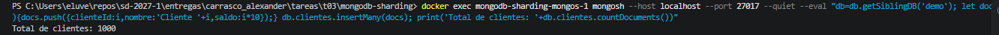
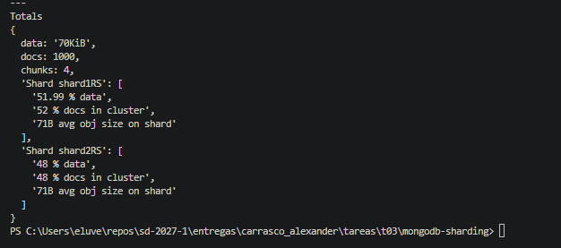

# T03 — Una implementación real de sharding: MongoDB

## 1. ¿Qué es MongoDB y para qué se utiliza el sharding?

MongoDB es una base de datos NoSQL orientada a documentos. La información se almacena en documentos agrupados en colecciones, en lugar de organizarse exclusivamente en tablas y filas como en una base de datos relacional.

De acuerdo con la documentación oficial de MongoDB, el *sharding* permite distribuir los datos entre varios servidores para que cada uno almacene una parte de la información y procese una parte de las operaciones. De esta manera, el sistema puede crecer cuando aumenta el volumen de datos o la carga de trabajo.

Un clúster con sharding está compuesto principalmente por tres elementos:

* **Shards:** almacenan diferentes partes de los datos de las colecciones particionadas.
* **`mongos`:** recibe las consultas de las aplicaciones y las dirige a los shards correspondientes.
* **Servidores de configuración (*config servers*):** guardan los metadatos que describen la organización y distribución de los datos en el clúster.


El sharding ayuda a distribuir la carga y aumentar la capacidad de almacenamiento, aunque también introduce complejidad en la configuración, la administración y el mantenimiento del sistema (MongoDB, s. f.-a).

## 2. ¿Cómo reparte MongoDB los datos y quién elige la llave?

MongoDB utiliza una **llave de partición (*shard key*)** para determinar cómo se distribuyen los documentos de una colección entre los shards. Esta llave puede estar formada por un campo o por varios campos del documento.

La llave se selecciona al diseñar y configurar la distribución de la colección. Por eso, es importante considerar qué valores contiene ese campo, cómo se distribuyen y qué consultas realizará habitualmente la aplicación.

La documentación de MongoDB describe las siguientes estrategias de distribución.

### 2.1. Particionado por rango (*Ranged Sharding*)

En esta estrategia, MongoDB distribuye los datos de acuerdo con rangos de valores de la llave de partición. Los valores cercanos tienen mayor probabilidad de quedar en el mismo fragmento (*chunk*).

Por ejemplo, si se utiliza el campo `edad`, se pueden distribuir los documentos según rangos de edad. Esto puede facilitar consultas que buscan personas dentro de un intervalo de edades, porque los datos relacionados pueden localizarse en una parte específica del clúster.

Sin embargo, el resultado depende de la llave elegida. Si se utiliza un campo que aumenta continuamente, como un número de pedido secuencial, las nuevas inserciones pueden concentrarse en el extremo de la distribución y provocar que un shard reciba una cantidad desproporcionada de escrituras.

### 2.2. Particionado por hash (*Hashed Sharding*)

En esta estrategia, MongoDB calcula un valor hash del campo seleccionado como llave de partición y utiliza ese valor para distribuir los documentos.

Por ejemplo, si se utiliza `idCliente` como llave con hash, MongoDB calcula internamente el hash correspondiente. La aplicación no necesita calcularlo manualmente.

Esta estrategia puede repartir mejor las inserciones cuando los valores originales aumentan de forma secuencial, porque los valores hash resultantes no conservan necesariamente el orden original.

La desventaja es que una consulta por rango del valor original puede necesitar consultar varios shards, ya que los valores cercanos pueden terminar distribuidos en distintas partes del clúster.

### 2.3. ¿Cómo se elige una buena llave?

La persona que diseña la base de datos elige la llave de partición. MongoDB proporciona recomendaciones y herramientas para analizar esa elección, pero no conoce automáticamente todas las necesidades de la aplicación.

Según la documentación, conviene considerar:

* **Cardinalidad:** cuántos valores distintos puede tener la llave.
* **Frecuencia de los valores:** si unos pocos valores concentran demasiados documentos u operaciones.
* **Patrón de consultas:** si las consultas habituales utilizan la llave y si necesitan buscar rangos.
* **Distribución de las escrituras:** si los nuevos documentos tienden a concentrarse en una sola parte de la colección.

Por lo tanto, no existe una llave ideal para todos los casos. Una buena elección busca distribuir adecuadamente los datos y facilitar las consultas más frecuentes (MongoDB, s. f.-b; MongoDB, s. f.-c; MongoDB, s. f.-d).

## 3. ¿Cómo encuentra MongoDB el shard correcto cuando llega una consulta?

MongoDB utiliza el componente `mongos` como enrutador de consultas. La aplicación se conecta a `mongos`, y este decide qué shard o shards deben recibir cada operación.

Los servidores de configuración almacenan los metadatos del clúster, incluida la información sobre los fragmentos y los rangos de valores que corresponden a cada shard. Las instancias de `mongos` mantienen una copia en caché de esos metadatos para dirigir las operaciones.

El proceso funciona de la siguiente manera:

1. La aplicación envía una consulta a `mongos`.
2. `mongos` analiza la consulta y la información de la llave de partición que contiene.
3. Utiliza los metadatos de distribución para determinar los shards que pueden contener los datos solicitados.
4. Envía la operación a los shards correspondientes y devuelve los resultados a la aplicación.

Si la consulta incluye suficiente información sobre la llave de partición, MongoDB puede dirigirla únicamente a los shards relevantes. En cambio, si no dispone de información suficiente para identificar dónde están los datos, puede enviar la consulta a varios shards.

Por ejemplo, una consulta que busca un documento por una llave de partición concreta puede dirigirse a un shard específico. Una consulta que no utiliza esa llave podría requerir una operación distribuida entre varios shards.

Esto demuestra que el enrutamiento no depende únicamente de tener varios servidores: también depende de la llave elegida y de cómo se construyen las consultas (MongoDB, s. f.-e; MongoDB, s. f.-f).

## 4. ¿Qué pasa cuando agregamos un shard?

Cuando se agrega un shard a un clúster, aparece una nueva capacidad de almacenamiento, pero inicialmente ese shard no contiene los datos que ya estaban distribuidos en los demás.

MongoDB dispone de un componente llamado *balancer* (balanceador), que trabaja en segundo plano y supervisa la distribución de los datos. Cuando se alcanzan determinados umbrales de migración, puede trasladar fragmentos entre shards para conseguir una distribución más equilibrada, respetando también las zonas configuradas.

Por ejemplo, imaginemos un clúster con dos shards que almacenan una colección. Si se agrega un tercer shard, MongoDB puede migrar algunos fragmentos de los servidores existentes al nuevo para repartir mejor los datos.

**¿Cuántos datos se mueven?**

No existe una cantidad fija que se aplique a todos los casos. Depende de la distribución inicial, de los fragmentos existentes, de los umbrales de migración y de las reglas de balanceo. Por eso, no es correcto afirmar que al agregar un shard se mueve toda la base de datos o que siempre se mueve exactamente la mitad de los datos.

El balanceo puede consumir ancho de banda y recursos durante las migraciones. Además, agregar un servidor no garantiza que todas las consultas mejoren, porque el resultado también depende de la llave de partición y de cómo se distribuye el trabajo (MongoDB, s. f.-g).

## 5. ¿Qué hace MongoDB con un shard caliente?

Un *shard caliente* (*hot shard*) es un shard que recibe una cantidad desproporcionada de operaciones o carga con respecto a los demás. Esto puede ocurrir aunque los datos estén repartidos entre varios servidores.

La documentación de MongoDB describe un caso en el que se utiliza una llave que aumenta continuamente, como un identificador de pedido secuencial. Las nuevas inserciones pueden concentrarse en el fragmento que contiene los valores más recientes. El shard que recibe esas escrituras se convierte en un shard caliente.

MongoDB puede utilizar el balanceador para mover fragmentos y mejorar la distribución de los datos. Sin embargo, el balanceo no elimina necesariamente el problema: si las nuevas escrituras siguen concentrándose en el mismo extremo de una llave monotónica, la carga puede volver a acumularse.

Para resolver o reducir este problema, se deben considerar varias medidas:

* Revisar si la llave de partición provoca una distribución desigual.
* Evaluar el particionado por hash cuando sea adecuado para las consultas de la aplicación.
* Comprobar si las consultas habituales incluyen la llave de partición y si están generando operaciones que abarcan demasiados shards.
* Considerar un cambio o refinamiento de la llave si el diseño actual produce una distribución deficiente.
* Analizar la carga real del sistema antes de agregar más shards, ya que más servidores no siempre resuelven un cuello de botella provocado por la llave.

Por ejemplo, si todos los pedidos nuevos tienen identificadores consecutivos y la colección utiliza ese campo mediante particionado por rango, es posible que las inserciones recientes se concentren en un solo shard. Una llave con hash puede ayudar a distribuir esas inserciones de manera más uniforme, aunque puede perjudicar las consultas por rango.

Por lo tanto, MongoDB cuenta con mecanismos para equilibrar los datos, pero elegir una buena llave de partición sigue siendo una decisión fundamental para evitar los shards calientes (MongoDB, s. f.-c; MongoDB, s. f.-h).

## 6. Demostración práctica con Docker Compose

### 6.1. Componentes del clúster

Se creó un clúster local con MongoDB 7.0 utilizando Docker Compose. Está compuesto por un servidor de configuración, dos *shards* y un enrutador `mongos`.

| Componente                | Nombre     | Función                                                          |
| ------------------------- | ---------- | ---------------------------------------------------------------- |
| Servidor de configuración | `cfgRS`    | Guarda los metadatos del clúster.                                |
| Primer shard              | `shard1RS` | Almacena una parte de los documentos.                            |
| Segundo shard             | `shard2RS` | Almacena otra parte de los documentos.                           |
| Enrutador                 | `mongos`   | Recibe y dirige las consultas hacia los shards correspondientes. |

Se verificó que los tres conjuntos de réplicas estuvieran en estado `PRIMARY` y que los dos shards se registraran correctamente en el clúster.

### 6.2. Configuración de la colección

Se habilitó el *sharding* en la base de datos `demo`, se creó un índice hash sobre `clienteId` y se particionó la colección `clientes`.

```javascript
sh.enableSharding("demo");

db = db.getSiblingDB("demo");

db.clientes.createIndex({
  clienteId: "hashed"
});

sh.shardCollection(
  "demo.clientes",
  { clienteId: "hashed" }
);
```

MongoDB confirmó que la colección `demo.clientes` quedó particionada correctamente.

### 6.3. Inserción de documentos


Se insertaron 1,000 documentos de prueba, cada uno con un identificador, un nombre y un saldo.

```javascript
db = db.getSiblingDB("demo");

let docs = [];

for (let i = 1; i <= 1000; i++) {
  docs.push({
    clienteId: i,
    nombre: "Cliente " + i,
    saldo: i * 10
  });
}

db.clientes.insertMany(docs);

print(
  "Total de clientes: " +
  db.clientes.countDocuments()
);
```

**Resultado obtenido:** `Total de clientes: 1000`.

### 6.4. Resultados de la distribución



Para revisar dónde quedaron almacenados los documentos se ejecutó el siguiente comando:

```javascript
db = db.getSiblingDB("demo");

printjson(
  db.clientes.getShardDistribution()
);
```

Los resultados obtenidos fueron los siguientes:

| Métrica                  | `shard1RS` | `shard2RS` |  Total |
| ------------------------ | ---------: | ---------: | -----: |
| Documentos               |        520 |        480 |  1,000 |
| Porcentaje de documentos |       52 % |       48 % |  100 % |
| Chunks                   |          2 |          2 |      4 |
| Tamaño aproximado        |     36 KiB |     33 KiB | 70 KiB |

*Nota:* los tamaños son aproximados y pueden variar según la versión de MongoDB y la forma en que se almacenen los datos.

### 6.5. Interpretación de los resultados


Los resultados muestran que MongoDB distribuyó los 1,000 documentos entre los dos shards. El primero almacenó 520 documentos, equivalentes al 52 %, mientras que el segundo almacenó 480 documentos, equivalentes al 48 %.

La distribución se realizó utilizando una clave de partición hash sobre `clienteId`. Esto permite distribuir los valores de la clave mediante sus valores hash, en lugar de organizarlos directamente por rangos numéricos.

La distribución obtenida fue relativamente equilibrada, aunque no exactamente igual. Esto demuestra cómo el *sharding* permite repartir los datos entre diferentes servidores para evitar que toda la información dependa de un único servidor.

### 8.6. Limitaciones de la demostración

La práctica se ejecutó localmente mediante Docker Compose y cada conjunto de réplicas cuenta con un solo miembro. Por lo tanto, aunque se utilizaron conjuntos de réplicas para configurar los servidores, esta demostración no ofrece redundancia real ante la falla de un miembro.

Además, la prueba utilizó una colección pequeña y datos sintéticos. En un entorno de producción sería necesario evaluar el crecimiento de los datos, la distribución de las consultas, las claves de partición, los shards con mayor carga y la configuración de réplicas.


## Conclusión

MongoDB es un ejemplo real de cómo se implementa el sharding en una base de datos distribuida. Para comprobar su funcionamiento, se configuró un clúster con dos shards mediante Docker Compose, se habilitó el sharding en una colección y se insertaron 1,000 documentos. Posteriormente, se utilizó getShardDistribution() para verificar cómo se distribuyeron los datos entre ambos shards.

Con esta práctica se observó que el sharding permite dividir una colección entre varios servidores, mientras que mongos funciona como punto de entrada para recibir y dirigir las consultas. Los servidores de configuración almacenan los metadatos del clúster y el balanceador puede redistribuir fragmentos cuando es necesario.

Una de las principales conclusiones es que distribuir los datos no consiste solamente en agregar servidores. También es necesario elegir una clave de partición adecuada, conocer los patrones de consulta y vigilar que la carga no se concentre en un solo shard. Aunque agregar shards aumenta la capacidad potencial del clúster, no garantiza por sí mismo un mejor rendimiento, ya que este depende en gran medida del diseño de la clave de partición y de la distribución de los datos y las operaciones.

## Fuentes consultadas

1. MongoDB. (s. f.). *Sharding*. MongoDB Manual. https://www.mongodb.com/docs/manual/sharding/
2. MongoDB. (s. f.). *Shard keys*. MongoDB Manual. https://www.mongodb.com/docs/manual/core/sharding-shard-key/
3. MongoDB. (s. f.). *Hashed sharding*. MongoDB Manual. https://www.mongodb.com/docs/manual/core/hashed-sharding/
4. MongoDB. (s. f.). *Config servers*. MongoDB Manual. https://www.mongodb.com/docs/manual/core/sharded-cluster-config-servers/
5. MongoDB. (s. f.). *Routing with mongos*. MongoDB Manual. https://www.mongodb.com/docs/manual/core/sharded-cluster-query-router/
6. MongoDB. (s. f.). *Sharded cluster balancer*. MongoDB Manual. https://www.mongodb.com/docs/manual/core/sharding-balancer-administration/
7. MongoDB. (s. f.). *Troubleshoot shard keys*. MongoDB Manual. https://www.mongodb.com/docs/manual/core/sharding-troubleshooting-shard-keys/
