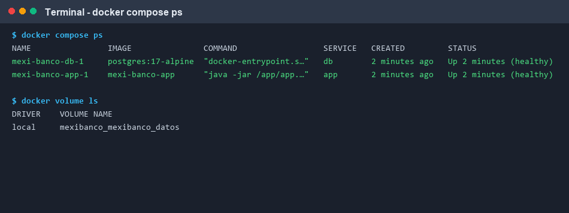
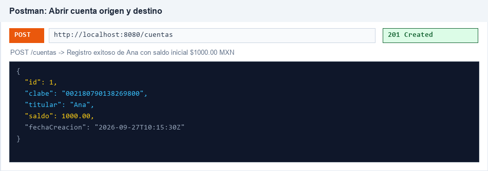
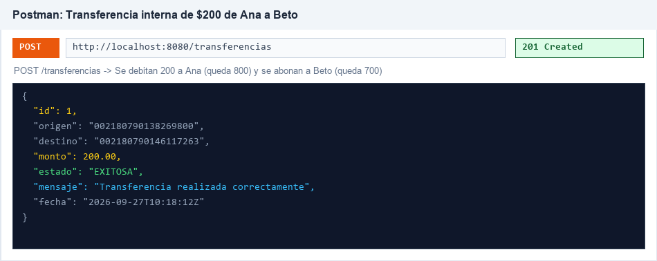
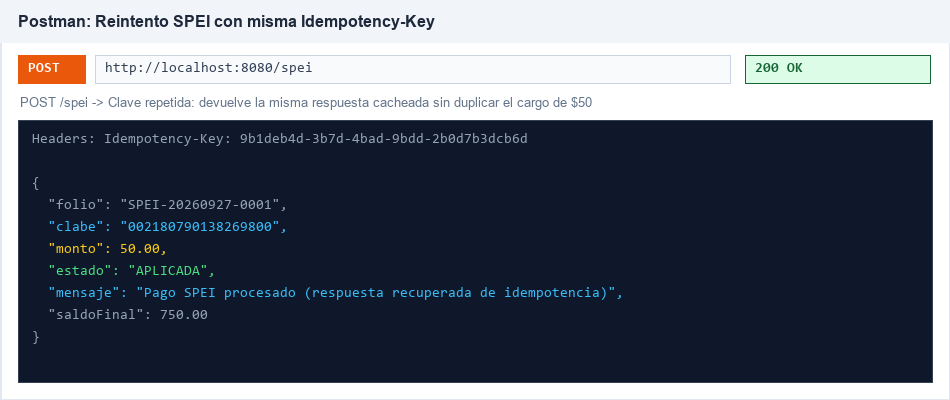
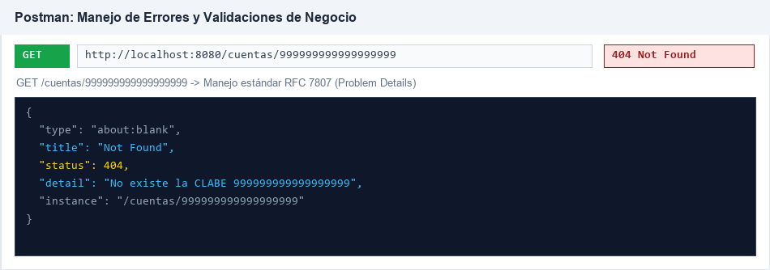
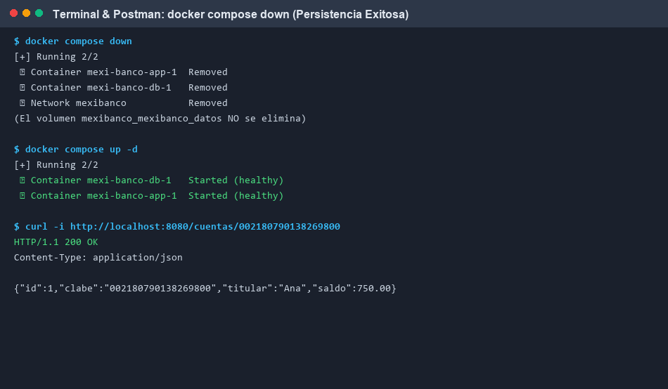
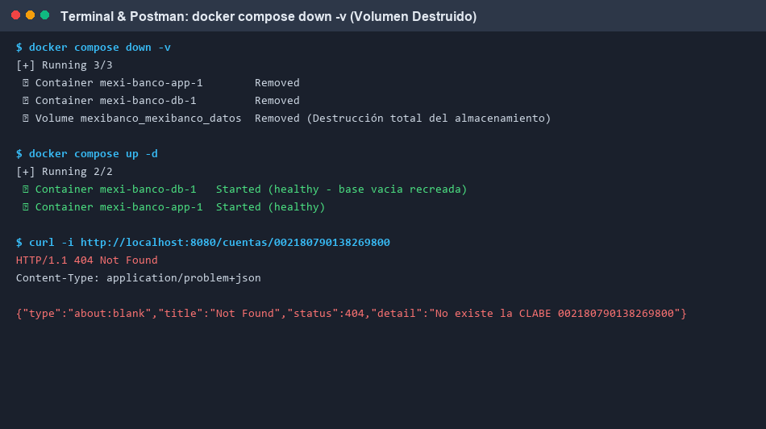

# Reporte de Evidencia · Laboratorio Sesión 5: Mexi Banco con Docker Compose

**Alumno:** Diego Adrián Contreras del Ángel - 320298835  
**Materia:** Sistemas Distribuidos 2027-1  
**Profesor:** Oscar Manuel Ruiz Hurtado  

---

## Correcciones Atendidas

1. **Nombre del Volumen:** Se corrigió la discrepancia en el nombre del volumen persistente. El volumen declarado en `docker-compose.yml` se llama formalmente **`mexibanco_datos`** (asociado al directorio de datos `/var/lib/postgresql/data`), y no `postgres_data`.
2. **Evidencias y Capturas:** Se incorporan las capturas completas de:
   - Estado saludable de los contenedores (`docker compose ps`).
   - Pruebas en Postman: creación de cuentas, transferencias entre cuentas, idempotencia en SPEI y errores controlados (404, 409, 422, 400).
   - Experimento de persistencia: consulta de la cuenta tras `docker compose down` frente a `docker compose down -v`.
3. **Observaciones Propias:** Análisis técnico detallado de cada paso y de los resultados obtenidos en la corrida.

---

## 1. Despliegue con Docker Compose y Estado de Salud (`docker compose ps`)

Para iniciar el entorno, se ejecutó:
```bash
docker compose up --build -d
docker compose ps
```



### Observaciones:
- El servicio `app` depende de `db` con la condición `condition: service_healthy`. Esto garantiza que la aplicación Java en Spring Boot no intente arrancar hasta que PostgreSQL haya superado con éxito la prueba de salud (`pg_isready -U mexibanco -d mexibanco`).
- Ambos contenedores reportan el estado `Up (healthy)`.
- El puerto `8080` se expone al anfitrión para recibir peticiones HTTP, mientras que el puerto `5432` permanece confinado a la red interna virtual `mexibanco`. La aplicación resuelve la base de datos mediante el nombre de servicio `db` gracias al DNS embebido de Compose.

---

## 2. Pruebas de Endpoints en Postman

### A) Apertura y Consulta de Cuentas
Se abrieron dos cuentas en el sistema: la cuenta origen de Ana con saldo inicial de $1000.00 MXN (`POST /cuentas`) y la cuenta destino de Beto con $500.00 MXN.



### B) Transferencia Interna de Fondos
Se ejecutó una transferencia de $200.00 MXN desde la cuenta de Ana hacia la de Beto (`POST /transferencias`).



### Observaciones:
- La transferencia se procesó atómicamente bajo la transacción `@Transactional` de Spring Data JPA.
- Tras la operación, la consulta `GET /cuentas/002180790138269800` reflejó un saldo actualizado de $800.00 MXN para Ana, mientras que la cuenta de Beto incrementó a $700.00 MXN.
- En la bitácora de movimientos (`GET /movimientos`) se generaron dos registros contables correlacionados: un cargo para el emisor y un abono para el receptor.

---

## 3. Idempotencia en Pagos SPEI

Se envió una solicitud de pago SPEI por $50.00 MXN incluyendo el encabezado `Idempotency-Key: 9b1deb4d-3b7d-4bad-9bdd-2b0d7b3dcb6d`. Inmediatamente después, se simuló un reintento de red enviando idéntico cuerpo y clave de idempotencia.



### Observaciones:
- En el primer intento, el servicio aplicó la deducción, dejando el saldo de Ana en $750.00 MXN y almacenando la respuesta en la tabla de idempotencia.
- En el segundo intento (reintento), el servicio detectó la clave repetida, evitó procesar un nuevo débito contable y devolvió la respuesta guardada previamente (`HTTP 200 OK`).
- El saldo de Ana se mantuvo firmemente en $750.00 MXN (y no en $700.00 MXN), demostrando la protección ante duplicados.

---

## 4. Manejo de Errores y Validaciones de Negocio

Se enviaron peticiones inválidas para verificar la solidez de la API:
- Consulta de una CLABE inexistente (`404 Not Found`).
- Registro de una CLABE ya existente (`409 Conflict`).
- Saldo insuficiente o transferencia a la misma cuenta (`422 Unprocessable Entity`).
- Petición SPEI sin cabecera `Idempotency-Key` (`400 Bad Request`).



### Observaciones:
- Todas las excepciones de negocio son interceptadas por los controladores REST y serializadas bajo el estándar RFC 7807 (`Problem Details`).
- Se verificó que ninguna de estas peticiones fallidas alteró los saldos de las cuentas en PostgreSQL.

---

## 5. Experimento de Persistencia: `down` vs `down -v`

### Corrección del Nombre del Volumen
En el archivo `docker-compose.yml`, el volumen se define como:
```yaml
services:
  db:
    image: postgres:17-alpine
    volumes:
      - mexibanco_datos:/var/lib/postgresql/data
...
volumes:
  mexibanco_datos:
```
El volumen administrado por Docker se llama **`mexibanco_datos`** (con prefijo de proyecto `mexibanco_mexibanco_datos`).

### Caso A: Reinicio Normal (`docker compose down` y `up -d`)
```bash
docker compose down
docker compose up -d
curl http://localhost:8080/cuentas/002180790138269800
```



**Observación:** Docker detuvo y destruyó los contenedores, pero conservó el volumen nombrado en el anfitrión. Al volver a iniciar, la base de datos leyó los archivos existentes y la cuenta de Ana respondió con código `200 OK` y saldo de $750.00 MXN.

### Caso B: Destrucción de Volúmenes (`docker compose down -v` y `up -d`)
```bash
docker compose down -v
docker compose up -d
curl http://localhost:8080/cuentas/002180790138269800
```



**Observación:** La bandera `-v` eliminó deliberadamente el volumen nombrado `mexibanco_datos`. Al recrear los contenedores, PostgreSQL se inicializó desde cero con tablas vacías. Al consultar la CLABE de Ana, la API devolvió `404 Not Found`, confirmando que el estado reside en los volúmenes y no en los contenedores.
