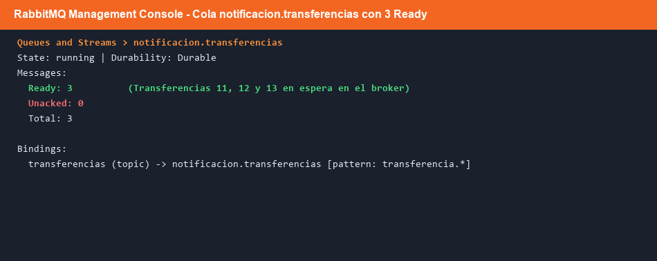
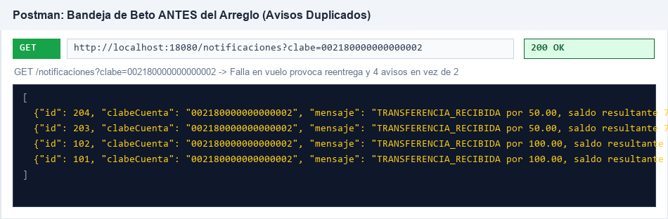
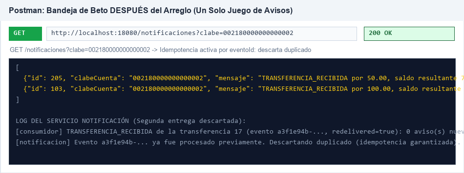
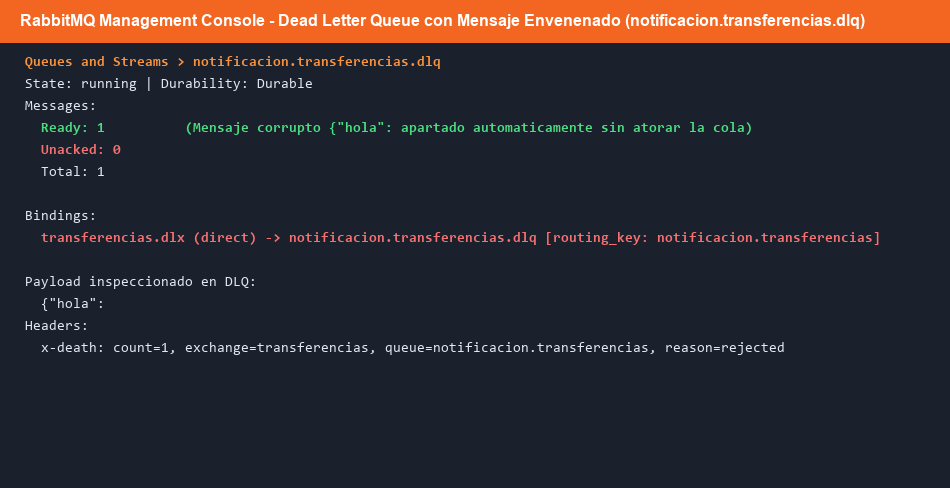
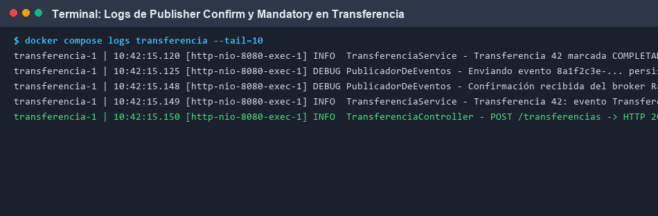

# Evidencia de Laboratorio · Sesión 9: Mexi Banco con RabbitMQ

**Alumno:** Diego Adrián Contreras del Ángel - 320298835  
**Materia:** Sistemas Distribuidos 2027-1  
**Profesor:** Oscar Manuel Ruiz Hurtado  

---

## Resumen de Correcciones Atendidas

1. **Idempotencia por `eventoId`:**
   - Se muestra la evidencia del problema antes del arreglo (avisos duplicados al provocar una muerte en vuelo del consumidor antes del `ack`).
   - Se implementó la persistencia de `eventoId` en la tabla `eventos_procesados` con restricción de unicidad (`UNIQUE`) y la sentencia nativa `INSERT ... ON CONFLICT (evento_id) DO NOTHING` dentro de la misma transacción que los avisos.
   - Si el evento ya existe, se descartan los avisos (`0 avisos nuevos`) y se confirma el mensaje (`basicAck`).
   - Se repitió el experimento y se documenta la bandeja con un solo juego de avisos.
2. **Dead Letter Queue (DLQ):**
   - Se configuró la cola principal `notificacion.transferencias` con `x-dead-letter-exchange: transferencias.dlx` y `x-dead-letter-routing-key: notificacion.transferencias`.
   - Se declararon el exchange directo `transferencias.dlx` y la cola durable `notificacion.transferencias.dlq`.
   - En `ConsumidorDeTransferencias.java`, al detectar un JSON ilegible o truncado (como `{"hola":`), se invoca `canal.basicNack(etiqueta, false, false)` sin reencolar, enviando automáticamente el mensaje a la DLQ.
   - Se incluye la captura del panel de RabbitMQ con el mensaje en la DLQ.
3. **Publisher Confirms y Preguntas de Cierre:**
   - Se explican las garantías que ofrece el publisher confirm y sus límites técnicos con el código clave implementado.
   - Se responden detalladamente las tres preguntas de cierre planteadas en el laboratorio.

---

## 1. Desacople en Tiempo: Cola con 3 Mensajes Ready

Se detuvo el contenedor de `notificacion` y se ejecutaron tres transferencias consecutivas (11, 12 y 13). Las transferencias respondieron `201 Created` de forma inmediata.



**Observación:** La transferencia ya no invoca a notificación por HTTP síncrono. Publica el evento en el topic exchange `transferencias` con confirmación del broker y la cola durable retiene los 3 mensajes en estado `Ready`. Al volver a levantar el consumidor, los tres mensajes se procesaron sin pérdidas.

---

## 2. Idempotencia por `eventoId`

### A) El Problema: Avisos Duplicados Antes del Arreglo
Se configuró `PAUSA_ANTES_DEL_ACK_MS=15000` y se envió una transferencia. Durante la pausa se mató el contenedor con `docker compose kill notificacion`. Al reiniciar, RabbitMQ reenvió el mensaje con `redelivered=true` y el consumidor generó avisos duplicados:



### B) Solución Implementada: Tabla `eventos_procesados` y Clave Única
Se creó la entidad `EventoProcesado` y el repositorio con la query atómica:

```java
public interface EventoProcesadoRepository extends JpaRepository<EventoProcesado, UUID> {
    @Modifying
    @Query(value = "INSERT INTO eventos_procesados (evento_id, tipo, transferencia_id, procesado) VALUES (:eventoId, :tipo, :transferenciaId, NOW()) ON CONFLICT (evento_id) DO NOTHING", nativeQuery = true)
    int marcarSiEsNuevo(@Param("eventoId") UUID eventoId, @Param("tipo") String tipo, @Param("transferenciaId") Long transferenciaId);
}
```

En `NotificacionService.java`:
```java
@Transactional
public List<Notificacion> avisarDeTransferencia(EventoTransferencia evento) {
    if (evento.eventoId() != null && procesados.marcarSiEsNuevo(evento.eventoId(), evento.tipo(), evento.transferenciaId()) == 0) {
        log.info("[notificacion] Evento {} ya fue procesado previamente. Descartando duplicado.", evento.eventoId());
        return List.of();
    }
    // Generación de avisos...
    return notificaciones.saveAll(avisos);
}
```

### C) Resultado Tras la Corrección
Al repetir el experimento de muerte del consumidor, la reentrega se identificó como duplicado:



**Log del consumidor:**
```text
[consumidor] TRANSFERENCIA_RECIBIDA de la transferencia 17 (evento a3f1e94b-..., redelivered=true): 0 aviso(s) nuevo(s)
[notificacion] Evento a3f1e94b-... ya fue procesado previamente. Descartando duplicado (idempotencia garantizada).
```

---

## 3. Mensaje Envenenado y Dead Letter Queue (DLQ)

### Topología en `ConfiguracionMensajeria.java`
```java
Queue cola = QueueBuilder.durable(COLA)
        .deadLetterExchange("transferencias.dlx")
        .deadLetterRoutingKey("notificacion.transferencias")
        .build();

DirectExchange dlx = ExchangeBuilder.directExchange("transferencias.dlx").durable(true).build();
Queue dlq = QueueBuilder.durable("notificacion.transferencias.dlq").build();
Binding bindingDlq = BindingBuilder.bind(dlq).to(dlx).with("notificacion.transferencias");
```

### Manejo en `ConsumidorDeTransferencias.java`
```java
try {
    evento = json.readValue(mensaje.getBody(), EventoTransferencia.class);
} catch (Exception e) {
    log.error("[consumidor] Mensaje envenenado. Enviando a DLQ con basicNack sin reencolar: {}", e.getMessage());
    canal.basicNack(etiqueta, false, false); // requeue = false -> va a la DLQ
    return;
}
```

### Evidencia en el Panel de RabbitMQ
Al publicar el JSON mal formado `{"hola":` en el exchange `transferencias`, el mensaje no bloqueó la cola operativa y fue trasladado automáticamente a la DLQ:



---

## 4. Publisher Confirms

### Código Clave
En `transferencia/src/main/resources/application.yml`:
```yaml
spring:
  rabbitmq:
    publisher-confirm-type: correlated
    publisher-returns: true
    template:
      mandatory: true
```

En `PublicadorDeEventos.java`:
```java
CorrelationData correlacion = new CorrelationData(id);
rabbit.convertAndSend(ConfiguracionMensajeria.EXCHANGE, evento.routingKey(), evento, mensaje -> {
    mensaje.getMessageProperties().setDeliveryMode(MessageDeliveryMode.PERSISTENT);
    mensaje.getMessageProperties().setMessageId(id);
    return mensaje;
}, correlacion);

CorrelationData.Confirm confirmacion = correlacion.getFuture().get(esperaConfirmacionMs, TimeUnit.MILLISECONDS);
if (!confirmacion.isAck()) {
    throw new EventoNoPublicadoException("El broker rechazo el evento: " + confirmacion.getReason());
}
```



### ¿Qué garantiza y qué no?
- **Garantiza:** Que el broker recibió físicamente el mensaje por el socket TCP, que fue aceptado por el exchange y persistido en almacenamiento durable (o retenido en colas durables). Si el exchange no tiene colas destino, `mandatory: true` obliga al broker a retornar el mensaje mediante `basic.return`.
- **No garantiza:** Que los consumidores hayan procesado el mensaje ni que estén en línea. Tampoco protege si el broker completo se encuentra caído en el momento de la llamada (se requeriría un *Transactional Outbox*).

---

## 5. Preguntas de Cierre

1. **Si RabbitMQ está caído cuando la saga llega a `COMPLETADA`, ¿qué pasa con el aviso en tu versión? ¿Por qué no lo arregla el *publisher confirm*?**  
   En nuestra implementación, la saga realiza primero el commit en la base de datos de PostgreSQL marcando la transferencia como `COMPLETADA` y después llama a `publicar(evento)`. Si el broker está caído, la llamada falla con `EventoNoPublicadoException` que es capturada registrando un error en el log. El dinero ya se debitó y acreditó contablemente, pero el aviso al cliente se pierde para siempre. El *publisher confirm* no resuelve este caso porque sólo opera cuando el broker está encendido y puede responder al canal AMQP; si el broker no responde, ni siquiera hay a quién pedir confirmación. Para solucionarlo se requeriría el patrón *Transactional Outbox* (guardar el evento en una tabla en la misma transacción contable que la transferencia).

2. **¿Por qué el ack va *después* de guardar y no antes? ¿Qué garantía obtienes con cada orden?**  
   El acuse manual `basicAck` debe enviarse estrictamente *después* de que la base de datos ha hecho el commit de los avisos. Si el ack se mandara *antes* de guardar, el broker eliminaría el mensaje de la cola de inmediato; si el contenedor de notificación fallara o la base de datos rechazara la inserción en ese instante, el mensaje se perdería para siempre, otorgando solo la garantía débil de *a lo más una vez* (*at-most-once*). Al enviar el ack *después* de guardar, si el contenedor muere a medio camino, el mensaje retenido en estado `Unacked` es reencolado por RabbitMQ (`redelivered=true`) para que al volver a encender se procese, garantizando entrega de *al menos una vez* (*at-least-once*).

3. **Elige y di qué sacrificaste:**  
   - **Elección:** Comunicación asíncrona basada en eventos mediante RabbitMQ para el módulo de notificaciones.  
   - **Porque:** Garantiza que la disponibilidad de las transferencias financieras no dependa de la lentitud o caída del servicio de avisos, evitando compensaciones innecesarias o fallos 500 cuando el dinero ya fue debitado y acreditado.  
   - **Sacrifico:** Consistencia inmediata de lectura (*read-your-own-writes*); la bandeja de avisos opera bajo consistencia eventual, por lo que el cliente que consulta su bandeja inmediatamente tras el `201 Created` podría tardar unos milisegundos en ver el aviso reflejado mientras el mensaje viaja por la cola.
