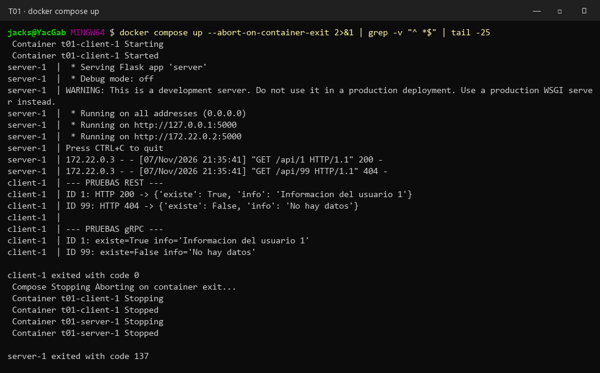
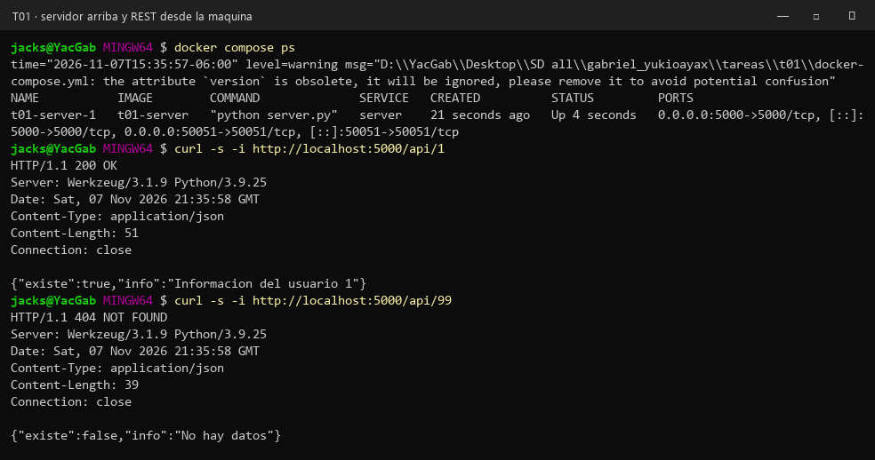
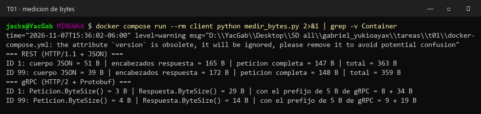
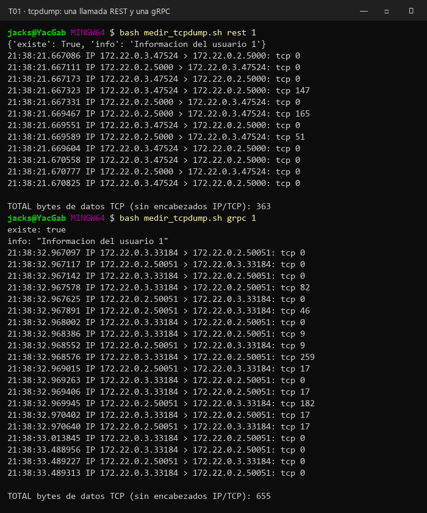
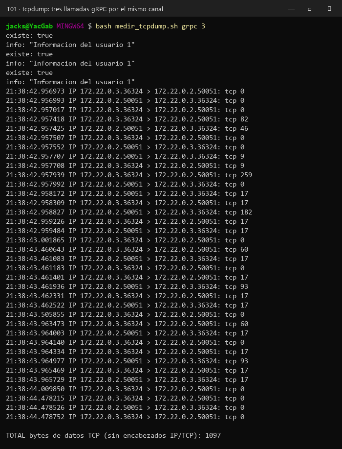

# T01 · El mismo servicio, por REST y por gRPC

El servicio es deliberadamente simple, recibe un ID y regresa la información que tiene guardada para ese ID, y si no existe contesta que no hay datos, la "base de datos" es un diccionario en memoria con dos registros (`"1"` y `"2"`).

## Diseño: dónde quedó la lógica

La lógica vive en un solo archivo, `logic.py`, con la función `consultar_datos(id)`, que regresa una pareja `(existe, info)`, y es lo único que sabe buscar en el diccionario, los dos controladores la importan y la llaman igual, así que no hay dos programas, hay uno solo con dos puertas.

```
               +-----------------------------+
 cliente  ---> | REST (Flask, puerto 5000)   | ---+
 (client.py)   +-----------------------------+    |     +----------------------------+
               +-----------------------------+    +---> | logic.py                   |
          ---> | gRPC (grpcio, puerto 50051) | ---+     | consultar_datos(id)        |
               +-----------------------------+          +----------------------------+
                      server.py (un solo proceso)
```

`server.py` levanta los dos controladores en el mismo proceso, el de gRPC en un hilo aparte y el de Flask en el hilo principal, los dos llaman a `consultar_datos` y lo único que cambia es cómo reciben la pregunta y cómo devuelven la respuesta:

| | REST (`rest_buscar`) | gRPC (`BusquedaServicer.Buscar`) |
|---|---|---|
| Cómo llega el ID | en la ruta, `GET /api/<id>` | dentro del mensaje `Peticion { string id = 1; }` |
| Contrato | ninguno escrito, el cliente tiene que saber la forma del JSON | el `service.proto`, del que se genera el código del cliente y del servidor |
| Cómo responde | un JSON en texto, `{"existe": ..., "info": ...}` | el mensaje binario `Respuesta { bool existe = 1; string info = 2; }` |
| Cómo dice que no existe | con el código HTTP, **200** si existe y **404** si no | la llamada sale bien (status `OK`) y el que avisa es el campo `existe = false` |
| Transporte | HTTP/1.1, una conexión por petición (Werkzeug manda `Connection: close`) | HTTP/2, un solo canal que se reusa entre llamadas |

O sea que en REST el "no hay datos" lo dice el protocolo con el 404 y en gRPC lo dice el mensaje, también se pudo haber contestado en gRPC con `NOT_FOUND`, pero preferí que los dos regresaran exactamente lo mismo que da `consultar_datos`, para que se note que la lógica no cambió, solo la forma de empaquetarla.

## Archivos

| Archivo | Qué es |
|---|---|
| `logic.py` | la lógica compartida y el diccionario |
| `server.py` | los dos controladores, REST y gRPC, en un proceso |
| `service.proto` | el contrato de gRPC |
| `client.py` | el cliente, llama al ID 1 (existe) y al 99 (no existe) por las dos interfaces |
| `Dockerfile.server`, `Dockerfile.client` | las imágenes, las dos generan el código de gRPC desde el `.proto` al construirse |
| `docker-compose.yml` | levanta los dos en la red que crea compose, el cliente llega al servidor por su nombre, `server` |
| `medir_bytes.py` | mide el tamaño del JSON y de los mensajes Protobuf |
| `una_llamada.py`, `medir_tcpdump.sh` | hacen una llamada y la miden en la red con `tcpdump` |
| `evidencia/` | las capturas de abajo |

## Cómo se levanta

```bash
docker compose up --build --abort-on-container-exit
```

El servidor se queda escuchando en el 5000 y en el 50051, el cliente espera 3 segundos, hace sus cuatro llamadas, imprime lo que le contestaron y se sale, y con `--abort-on-container-exit` se apaga todo cuando el cliente termina.

## Evidencia de que corre

**`docker compose up`**: en el log del servidor aparecen las dos peticiones REST, la del ID 1 con 200 y la del 99 con 404, y el cliente imprime lo mismo para REST y para gRPC, con el ID 1 encuentra `Informacion del usuario 1` y con el 99 contesta `No hay datos`.



**Desde mi máquina**: con el servidor arriba, `docker compose ps` muestra los dos puertos publicados y con `curl -i` se ven los códigos, `200 OK` con `Content-Length: 51` para el ID 1 y `404 NOT FOUND` con `Content-Length: 39` para el 99.



## Punto extra: cuántos bytes viajan

Lo medí de dos formas, primero el tamaño de lo que se manda, y luego lo que de verdad pasó por la red.

**1. El tamaño del cuerpo** (`medir_bytes.py`, corrido dentro del contenedor del cliente con `docker compose run --rm client python medir_bytes.py`). Para REST tomé `len(r.content)` del JSON y le sumé la línea de estado y los encabezados que llegaron, y para gRPC usé `ByteSize()` de cada mensaje, que es lo que ocupa ya serializado en Protobuf.



| ID 1 | REST | gRPC |
|---|---:|---:|
| Petición | 147 B (la línea `GET` y sus encabezados, el ID va en la ruta) | 3 B (`Peticion`) |
| Respuesta, solo el contenido | 51 B de JSON | 29 B (`Respuesta`) |
| Encabezados de la respuesta | 165 B | se miden abajo |

El mensaje en sí sale bastante más chico en Protobuf, porque no manda los nombres de los campos (`"existe"`, `"info"`), solo su número de campo y el valor, y el booleano ocupa 2 bytes en lugar de escribir `true` con comillas y llaves alrededor.

**2. En la red, con `tcpdump`** (`medir_tcpdump.sh`). Levanté el servidor con `docker compose up -d server` y metí un contenedor de `nicolaka/netshoot` en la misma red del servidor (`--net container:t01-server-1`), con `tcpdump -nn -q` filtrando el puerto 5000 o el 50051, mientras el cliente hacía una sola llamada con el ID 1, `tcpdump -q` imprime al final de cada línea cuántos bytes de datos llevaba ese segmento TCP (sin contar los encabezados de IP ni de TCP), y con `awk` los sumé.



| Una sola llamada, conexión nueva | Bytes de datos TCP |
|---|---:|
| REST | **363 B** (147 de la petición + 165 de encabezados + 51 del JSON) |
| gRPC | **655 B** |

Aquí me salió al revés de lo que vimos en clase, con una sola llamada gRPC mandó casi el doble, y es porque abrir un canal de HTTP/2 cuesta, antes de la llamada se mandan el prefacio y los `SETTINGS` (los 82 y 46 B), los acuses de 9 B, y la primera petición pesa 259 B porque la tabla de HPACK está vacía y los encabezados (`:path /data.Busqueda/Buscar`, `content-type: application/grpc`, `user-agent`, etc.) se mandan completos, además, la respuesta de 182 B lleva sus encabezados, los 34 B del mensaje con el prefijo de 5 B que pone gRPC y los *trailers* con el `grpc-status`, y los de 17 B son `PING` y `WINDOW_UPDATE` de HTTP/2.

Entonces repetí lo mismo pero con **tres llamadas por el mismo canal**:



La primera llamada vuelve a costar lo mismo, pero la segunda y la tercera ya solo mandan **60 B** de petición y **93 B** de respuesta, porque HPACK ya tiene los encabezados en su tabla y solo manda índices, más unos 68 B de `PING`/`WINDOW_UPDATE` por llamada, en cambio, REST con este servidor paga los 363 B en cada llamada, porque Werkzeug cierra la conexión cada vez y además tiene que volver a hacer el saludo de TCP.

| | REST | gRPC |
|---|---:|---:|
| 1ª llamada | 363 B | 655 B (incluye abrir el canal) |
| Cada llamada siguiente | 363 B | 153 B (60 + 93), o unos 221 B contando los pings |

Por eso el ejemplo de clase de 180 contra 60 bits es más bien del cuerpo, en el cuerpo Protobuf sí gana (29 contra 51 B, y 3 contra una ruta con el ID en texto), pero en la red pesa más el protocolo que el mensaje, para una sola llamada suelta gRPC no conviene por bytes, y conviene cuando el canal se queda abierto y se hacen muchas llamadas, que es justo el caso de servicios internos hablando entre ellos todo el tiempo.

## Fuentes

- gRPC, *Introduction to gRPC*: https://grpc.io/docs/what-is-grpc/introduction/
- gRPC, *gRPC over HTTP2* (formato del mensaje con el prefijo de 5 bytes): https://github.com/grpc/grpc/blob/master/doc/PROTOCOL-HTTP2.md
- Protocol Buffers, *Encoding*: https://protobuf.dev/programming-guides/encoding/
- RFC 7541, *HPACK: Header Compression for HTTP/2*: https://www.rfc-editor.org/rfc/rfc7541
