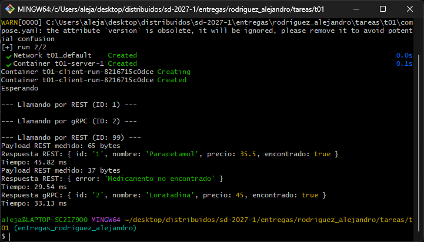
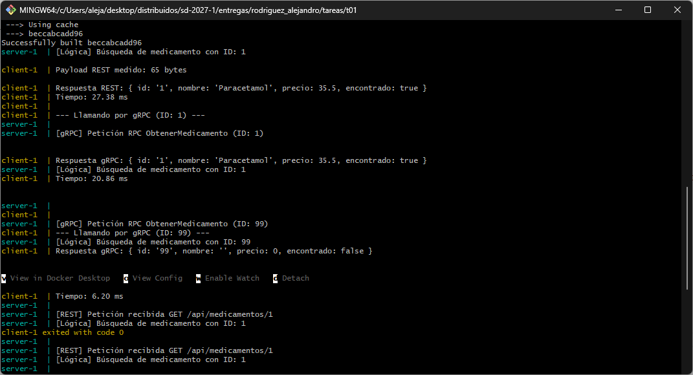

# Tarea 01: El mismo servicio por REST y por gRPC

**Alumno:** Alejandro Rodríguez Jaramillo - 320199866

## 1. Ejecución y Evidencia

El proyecto está organizado mediante Docker Compose y cuenta con un comprobador de salud automatizado. Para construir las imágenes, poner en marcha el servidor y ejecutar el cliente de forma coordinada, basta con correr el siguiente comando desde el directorio principal del proyecto:

    docker compose up --build

Esta instrucción iniciará el servidor y aguardará hasta que se encuentre completamente operativo para, de forma automática, iniciar el cliente y efectuar las peticiones necesarias hacia ambas interfaces de red. Una vez finalizadas las pruebas, es posible detener la ejecución de manera limpia presionando `Ctrl + C` y ejecutando posteriormente `docker compose down`.

**Evidencia de ejecución:**

La salida de la terminal presentada a continuación demuestra que ambas interfaces operan correctamente compartiendo la misma lógica de negocio, logrando procesar el identificador 1 de manera exitosa y gestionando adecuadamente un identificador inexistente:

## 2. Lógica

1. **Lógica de Negocio:** La función `buscarMedicamento` interactúa de forma directa con el diccionario almacenado en memoria, recibiendo únicamente un identificador para retornar el objeto de JavaScript correspondiente.
2. **Controlador REST en el Puerto 8080:** Utilizando Express, este controlador escucha peticiones HTTP, extrae el parámetro de la URL, invoca a `buscarMedicamento` y convierte la respuesta final al formato JSON.
3. **Controlador gRPC en el Puerto 9090:** A través del contrato `servicio.proto`, este controlador extrae el identificador del mensaje RPC entrante, invoca a `buscarMedicamento` y transforma el resultado a la estructura binaria optimizada de Protobuf.

## 3. Punto Extra

Se midió el peso de los datos transmitidos al consultar un medicamento existente en el catálogo, específicamente el Paracetamol con el identificador 1 vía REST y la Loratadina con el identificador 2 vía gRPC. La medición abarcó tanto el nivel de aplicación como el paquete completo a nivel de red.

### Capa de Aplicación
- **REST, 65 bytes:** Esta medida se obtuvo en el cliente al consultar el identificador 1 mediante la evaluación de la longitud de la respuesta en formato de texto. El formato JSON resulta pesado dado que transmite en texto plano todas las etiquetas clave como el nombre o el precio, incluyendo además las comillas y los espacios de formato.
- **gRPC, 26 bytes:** Este valor se calculó mediante las reglas formales de codificación de Protobuf al consultar el identificador 2. Su peso teórico es exacto y resulta de sumar 3 bytes correspondientes al identificador, 12 bytes del nombre, 9 bytes del precio y 2 bytes del valor booleano. En este protocolo no viajan los nombres de las variables, sino únicamente los valores ligados a un número de índice predefinido en el contrato.

### Capa de Red (Paquetes TCP capturados)
Utilizando el comando `tcpdump` desde el interior del contenedor del servidor, se capturaron los tamaños totales de los datos transmitidos en la red:
- **REST, 300 bytes:** Esta cifra comprende los 65 bytes del cuerpo JSON sumados al peso íntegro de las cabeceras HTTP transmitidas en texto plano, así como la información de control fundamental que el protocolo TCP demanda para operar.
- **gRPC, 156 bytes:** Este volumen engloba los 26 bytes estructurados de Protobuf empaquetados dentro de un marco de transporte HTTP/2, el cual comprime las cabeceras y logra reducir drásticamente el tamaño final enviado a través de la red.

**Conclusión:** El protocolo gRPC reduce el peso de transmisión a casi la mitad en la capa de red y a una tercera parte en la capa de aplicación, validando así su alta eficiencia operativa para la comunicación interna entre sistemas.

## 4. Uso de Inteligencia Artificial

Para desarrollar la sección del punto extra, se empleó a Gemini como apoyo técnico para identificar las herramientas de medición más precisas en las distintas capas del sistema.

**Prompt de apoyo utilizado:**
> "¿Cuáles son las opciones más precisas para medir el tamaño exacto en bytes de peticiones REST y gRPC en Node.js, tanto a nivel de aplicación a través del código como a nivel de red empleando Docker?"

## 5. Correcciones Aplicadas

Se incorporaron modificaciones en el código para solventar inconsistencias detectadas en la validación de protocolos y para asegurar una ejecución estable y secuencial de los contenedores:
1. **Unificación de Consultas:** Se reestructuró la rutina de pruebas en el archivo `client.js` para consultar el mismo identificador "1" a través de ambos protocolos, tanto REST como gRPC. Esto demuestra de manera inequívoca que ambas interfaces interactúan con la misma lógica subyacente y devuelven la información de manera consistente.
2. **Control de Errores RPC:** Se implementó una consulta gRPC adicional empleando el identificador inexistente "99" con el propósito de verificar la resiliencia del sistema y el manejo adecuado de resultados vacíos por parte del servidor.
3. **Arranque Secuencial Seguro:** Se eliminó la función `setTimeout` que pausaba al cliente con tiempos fijos. En sustitución, se configuró un comprobador de salud basado en una petición HTTP desde Node.js en el archivo `compose.yaml` para validar el estado del servidor en el puerto 8080. El inicio del contenedor cliente quedó condicionado de manera estricta a esta validación mediante la directiva de dependencia correspondiente.

## 6. Referencias

[1] OpenJS Foundation, "Node.js v20.x Documentation: Buffer," Node.js API Reference. En línea. Disponible en: [https://nodejs.org/docs/latest-v20.x/api/buffer.html](https://nodejs.org/docs/latest-v20.x/api/buffer.html)

[2] Google, "Protocol Buffers Encoding," Protobuf Documentation. En línea. Disponible en: [https://protobuf.dev/programming-guides/encoding/](https://protobuf.dev/programming-guides/encoding/)

[3] The Tcpdump Group, "tcpdump manual page," Tcpdump. En línea. Disponible en: [https://www.tcpdump.org/manpages/tcpdump.1.html](https://www.tcpdump.org/manpages/tcpdump.1.html)