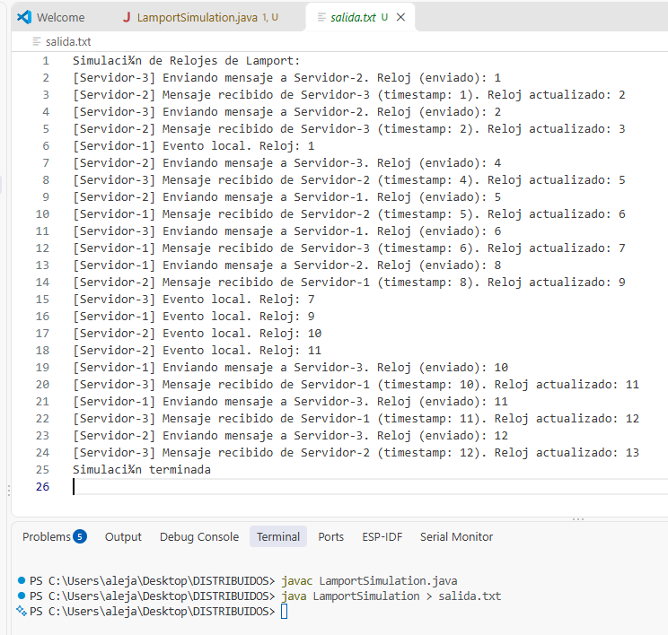

# T04 · ¿Qué reloj usan las tecnologías que conoces?

## 1. Apache Cassandra
1. **Qué es y para qué se usa:** Apache Cassandra es una base de datos NoSQL distribuida orientada a columnas, diseñada para manejar volúmenes masivos de datos con alta disponibilidad y tolerancia a fallos. Su arquitectura permite que el sistema continúe operando de manera ininterrumpida frente a particiones de red.
2. **Qué tiempo usa para ordenar:** Para ordenar los eventos, el sistema no emplea relojes lógicos ni vectoriales. Utiliza exclusivamente relojes físicos, registrando la marca de tiempo del sistema operativo del cliente o del nodo que coordina la petición.
3. **Qué orden garantiza y hasta dónde:** Cassandra garantiza un orden estricto de las operaciones únicamente a nivel de una misma llave de partición.
4. **Qué pasa cuando los relojes no coinciden:** Cuando ocurren escrituras concurrentes sobre un mismo registro, el sistema resuelve el conflicto mediante la política del último escritor ganador. Si los relojes físicos no coinciden por falta de sincronización, la base de datos ignora el desfase y confía en la marca de tiempo provista. Esto implica que una escritura con un reloj adelantado por error puede sobrescribir datos más recientes, lo que ocasiona una pérdida silenciosa de información.

## 2. Google Spanner
1. **Qué es y para qué se usa:** Google Spanner es una base de datos relacional distribuida a escala global. Proporciona transacciones con propiedades de atomicidad, consistencia, aislamiento y durabilidad, combinadas con una alta escalabilidad.
2. **Qué tiempo usa para ordenar:** Para determinar el orden de las transacciones, Spanner utiliza TrueTime, un mecanismo avanzado basado en relojes físicos altamente precisos y sincronizados mediante sistemas de posicionamiento global y relojes atómicos en cada centro de datos. En lugar de generar una marca de tiempo estática, TrueTime devuelve un intervalo de incertidumbre que delimita el tiempo real actual.
3. **Qué orden garantiza y hasta dónde:** El sistema garantiza un orden total estricto o linearizabilidad a lo largo de todo el sistema distribuido. Esto permite realizar lecturas de los datos más actualizados en cualquier ubicación geográfica.
4. **Qué pasa cuando los relojes no coinciden:** Spanner resuelve los desajustes obligando a las transacciones a esperar. Antes de confirmar una escritura, el sistema pausa la transacción hasta que el intervalo de incertidumbre haya transcurrido por completo. Si la red está congestionada o el reloj presenta errores, dicha ventana de tiempo crece y el sistema espera más tiempo para asegurar que las marcas de tiempo de transacciones causalmente relacionadas nunca se superpongan.

## 3. Apache Kafka
1. **Qué es y para qué se usa:** Apache Kafka es una plataforma distribuida de transmisión de eventos de alto rendimiento. Se emplea habitualmente como una bitácora inmutable para enrutar información en tiempo real entre múltiples servicios independientes.
2. **Qué tiempo usa para ordenar:** Para establecer el orden de los datos, Kafka prescinde de los relojes físicos de los productores de mensajes. El nodo líder asigna un número de secuencia monótono a cada evento en el instante exacto en que este se añade al sistema de almacenamiento.
3. **Qué orden garantiza y hasta dónde:** Esta arquitectura garantiza un orden total y estricto, pero su alcance se limita exclusivamente al interior de una misma partición. No existe ninguna garantía de orden global entre mensajes pertenecientes a particiones distintas.
4. **Qué pasa cuando los relojes no coinciden:** Dado que el orden de entrega depende enteramente del número de secuencia asignado por el servidor líder, Kafka ignora cualquier desfase en los relojes físicos de los clientes. Esto asegura que la causalidad local se mantenga intacta frente a problemas de sincronización temporal en los dispositivos emisores.

---

## Reto Opcional: Reloj de Lamport en Java

La simulación fue implementada en el archivo `lamport/LamportSimulation.java`, en el que tres servidores corren en hilos separados (`Threads`) simulando latencias de red impredecibles. Se empleó un `AtomicLong` para garantizar que la actualización concurrente de los relojes lógicos fuera atómica y libre de condiciones de carrera (*race conditions*).

### ¿Por qué la salida respeta la causalidad?

La salida del programa demuestra matemáticamente la regla de causalidad de Lamport: si el evento $a$ sucede antes que el evento $b$ ($a \rightarrow b$), entonces el reloj de $a$ es estrictamente menor al reloj de $b$ ($L(a) < L(b)$).

En la salida generada (ver `salida.txt` o la imagen de evidencia), esto se respeta en dos escenarios clave:

1. **Orden interno:** Cada evento local o de envío en un mismo servidor siempre muestra un valor de reloj numéricamente mayor al de su evento previo inmediato gracias a la instrucción `incrementAndGet()`.

2. **Orden entre procesos (Causalidad en red):** Cuando, por ejemplo, el *Servidor-1* envía un mensaje con *timestamp 2*, y el *Servidor-2* lo recibe, el código aplica la regla `Math.max(reloj_local, 2) + 1`. Si el *Servidor-2* estaba en el *timestamp 1*, el máximo será 2, y al sumar 1, su reloj saltará a 3. Dado que 3 es mayor que 2, queda registrado aritméticamente que la recepción (3) ocurrió estrictamente después del envío (2). Así, cualquier proceso posterior en el *Servidor-2* será un efecto causal del mensaje enviado por el *Servidor-1*.

### Código Fuente (`LamportSimulation.java`)

```java
import java.util.concurrent.atomic.AtomicLong;
import java.util.Random;

class Server implements Runnable {
    private final String serverName;
    private final AtomicLong lamportClock;
    private final Server[] connectedServers;
    private final Random randomNumberGenerator;

    public Server(String serverName, Server[] connectedServers) {
        this.serverName = serverName;
        this.lamportClock = new AtomicLong(0);
        this.connectedServers = connectedServers;
        this.randomNumberGenerator = new Random();
    }

    public String getServerName() {
        return serverName;
    }

    public void setConnectedServers(Server[] connectedServers) {
        System.arraycopy(connectedServers, 0, this.connectedServers, 0, connectedServers.length);
    }

    public void performLocalEvent() {
        long currentTimestamp = lamportClock.incrementAndGet();
        System.out.printf("[%s] Evento local. Reloj: %d%n", serverName, currentTimestamp);
    }

    public void sendMessageTo(Server destinationServer) {
        long currentTimestamp = lamportClock.incrementAndGet();
        System.out.printf("[%s] Enviando mensaje a %s. Reloj (enviado): %d%n", serverName, destinationServer.getServerName(), currentTimestamp);
        destinationServer.receiveMessageFrom(this, currentTimestamp);
    }

    public void receiveMessageFrom(Server senderServer, long receivedTimestamp) {
        long currentTimestamp = lamportClock.get();
        long newTimestamp = Math.max(currentTimestamp, receivedTimestamp) + 1;
        
        lamportClock.set(newTimestamp);
        
        System.out.printf("[%s] Mensaje recibido de %s (timestamp: %d). Reloj actualizado: %d%n", 
            serverName, senderServer.getServerName(), receivedTimestamp, newTimestamp);
    }

    @Override
    public void run() {
        int numberOfEvents = 3 + randomNumberGenerator.nextInt(3); 
        
        for (int eventIndex = 0; eventIndex < numberOfEvents; eventIndex++) {
            try {
                Thread.sleep(randomNumberGenerator.nextInt(500)); 
            } catch (InterruptedException exception) {
                Thread.currentThread().interrupt();
            }

            int actionType = randomNumberGenerator.nextInt(2);
            
            if (actionType == 0) {
                performLocalEvent();
            } else {
                Server destinationServer = connectedServers[randomNumberGenerator.nextInt(connectedServers.length)];
                
                while (destinationServer == this) {
                   destinationServer = connectedServers[randomNumberGenerator.nextInt(connectedServers.length)];
                }
                
                sendMessageTo(destinationServer);
            }
        }
    }
}

public class LamportSimulation {
    public static void main(String[] args) {
        System.out.println("=== Iniciando Simulación de Relojes de Lamport ===");
        
        Server server1 = new Server("Servidor-1", new Server[2]);
        Server server2 = new Server("Servidor-2", new Server[2]);
        Server server3 = new Server("Servidor-3", new Server[2]);
        
        server1.setConnectedServers(new Server[]{server2, server3});
        server2.setConnectedServers(new Server[]{server1, server3});
        server3.setConnectedServers(new Server[]{server1, server2});

        Thread thread1 = new Thread(server1);
        Thread thread2 = new Thread(server2);
        Thread thread3 = new Thread(server3);

        thread1.start();
        thread2.start();
        thread3.start();

        try {
            thread1.join();
            thread2.join();
            thread3.join();
        } catch (InterruptedException exception) {
            exception.printStackTrace();
        }
        
        System.out.println("=== Simulación Finalizada ===");
    }
}
```

### Evidencia de Ejecución

En la siguiente imagen se muestra la salida de la terminal al compilar y ejecutar la simulación, donde se puede observar claramente cómo los relojes se sincronizan y actualizan respetando la causalidad descrita:

